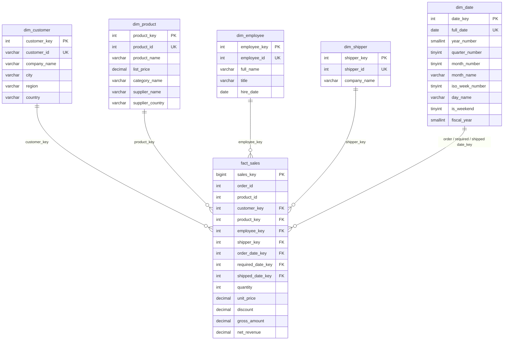

# Northwind Capstone: End-to-End Analytics Pipeline

An analytics project built on the Northwind Traders dataset. A Python pipeline loads the raw CSV files into a MySQL staging schema (`stg`), transforms them into a star schema (`dw`) with idempotent upsert SQL, and the warehouse is then used for statistical hypothesis testing (Jupyter) and an executive dashboard (Power BI).

```
GitHub CSV files ──► data/raw/ ──► stg schema (1:1 copy) ──► dw schema (star schema) ──► Jupyter notebook
                      Python          Python                      SQL upserts         └──► Power BI dashboard
```

---

## 1. Repository structure

```
northwind-capstone-pipeline/
├── .gitignore
├── README.md
├── requirements.txt
├── run_pipeline.py                  # one command runs the whole pipeline
├── data/
│   └── raw/                         # raw_*.csv files extracted with Python
├── sql/
│   ├── 01_create_db_and_schemas.sql # creates the stg and dw schemas
│   ├── 02_create_staging.sql        # 1:1 staging tables
│   ├── 03_create_warehouse.sql      # star schema tables + date generator
│   ├── 04_upsert_dimensions.sql     # idempotent upsert into dimensions
│   └── 05_upsert_fact_sales.sql     # idempotent upsert into the fact table
├── src/
│   ├── __init__.py
│   ├── config.py                    # connection settings from environment variables
│   ├── db_connector.py              # database connection and SQL file runner
│   ├── stage_raw_data.py            # downloads CSVs and loads them into stg
│   └── transform_warehouse.py       # runs scripts 04 and 05 and prints a summary
├── notebooks/
│   └── statistical_analysis.ipynb   # hypothesis testing on the dw schema
└── reports/
    └── northwind_executive_dashboard.pbix
```

---

## 2. Setup and how to run

### Requirements
- Python 3.10 or newer
- MySQL 8.0 or newer (the date generator uses common table expressions)
- Power BI Desktop and MySQL Connector/ODBC, for the dashboard only

### Steps

1. **Clone the repository** and open a terminal in the project folder.

2. **Install the Python libraries:**
   ```
   python -m pip install -r requirements.txt
   ```

3. **Create a `.env` file** in the project folder with your MySQL login. This file is listed in `.gitignore`, so the password never reaches GitHub.
   ```
   MYSQL_USER=root
   MYSQL_PASSWORD=your_password
   ```
   Optional: `MYSQL_HOST` (default `localhost`) and `MYSQL_PORT` (default `3306`).

4. **Run the pipeline:**
   ```
   python run_pipeline.py
   ```
   The first run takes a few minutes, because the date dimension (about 2.9 million rows) is generated. Later runs take seconds, because the generator is skipped when the dates already exist.

5. **Open the notebook** `notebooks/statistical_analysis.ipynb` in Jupyter and choose *Restart & Run All*.

6. **Open the dashboard** `reports/northwind_executive_dashboard.pbix` in Power BI Desktop. If asked, update the data source credentials to your own MySQL login.

### Expected pipeline output

```
Warehouse summary:
  dim_customer: 91
  dim_product: 77
  dim_employee: 9
  dim_shipper: 3
  dim_date: 2925593
  fact_sales rows: 2155
  total net revenue: 1265793.04
Pipeline finished.
```

---

## 3. Database architecture

### Two schemas

| Schema | Purpose | Content |
|---|---|---|
| `stg` | Raw copy of the source | One table per CSV file, same column names, no keys or constraints. Each run empties and reloads the tables. |
| `dw` | Analytical model | Star schema with surrogate keys, unique business keys and foreign keys. Loaded with upsert logic. |

**MySQL note.** In MySQL a schema and a database are the same object. The two layers are therefore created as two schemas (`stg` and `dw`) on the same server. They stay physically separate, and queries can still join across them (for example `stg.orders` and `dw.fact_sales`).

### Star schema (`dw`)



### Design decisions

- **Grain of the fact table:** one row per order line (one product in one order), built from `order_details` joined to `orders`. It is the most detailed level available, so any total (per order, customer or month) can be calculated from it.
- **Flattened product dimension:** category and supplier columns are stored inside `dim_product`, so reports can filter by category without extra joins.
- **Surrogate keys:** each dimension has an auto-numbered key, and the fact table references these keys. The original source ID is kept as a unique business key and is used for matching during the upsert.
- **Measures:** `gross_amount = quantity × unit_price` and `net_revenue = quantity × unit_price × (1 − discount)`.
- **Freight is not in the fact table.** Freight belongs to a whole order. Copying it to every order line would count it several times when summed.
- **Missing values:** customer `region` is empty for most non-US customers and is stored as `Not specified`, so it reads clearly in report filters. Other empty values stay `NULL`.

### Date dimension

`dw.dim_date` is generated in SQL (no CSV) with one row per day from **1990-01-01 to 9999-12-31** (2,925,592 days). Attributes: year, quarter, month number and name, year-month label, ISO week, day of month, day of year, day of week, day name, weekend flag, and fiscal year, quarter and month (fiscal year starting in January, configurable in the script).

An extra row with `date_key = -1` ("Unknown") is used for the 21 orders that were never shipped, so every fact row has a valid date key.

---

## 4. Idempotency and data quality

**How idempotency is achieved**
- Staging: each table is emptied and reloaded inside one transaction.
- Warehouse tables: `CREATE TABLE IF NOT EXISTS`.
- Date dimension: generated only if `1990-01-01` is not yet present.
- Dimensions and fact: `INSERT ... ON DUPLICATE KEY UPDATE` on the unique business key (`customer_id`, `product_id`, ..., and `(order_id, product_id)` for the fact table). Existing rows are updated, new rows are inserted, and nothing is duplicated.
- Dimensions are loaded before the fact table, because the fact table looks up their surrogate keys.

**Checks performed**

| Check | Result |
|---|---|
| Row count of each staging table equals its CSV file | ✅ all 11 tables |
| Leading zeros kept (e.g. territory `01581`) | ✅ |
| Special characters kept (e.g. `Berglunds snabbköp`) | ✅ |
| Text `NULL` in the CSV stored as a real NULL (21 unshipped orders) | ✅ |
| Orders and order lines without a matching customer, employee, shipper, product or order | ✅ 0 in all five checks |
| Fact rows = staging order lines | ✅ 2,155 = 2,155 |
| Revenue in `dw` = revenue calculated from `stg` | ✅ 1,265,793.04 |
| Second pipeline run gives identical counts, keys and revenue | ✅ |

Foreign keys on the fact table make orphan records impossible: the database rejects any fact row whose dimension key does not exist.

---

## 5. Statistical analysis

The notebook connects to `dw` and tests three business questions at a significance level of 0.05. Non-parametric tests were chosen where the data is not normally distributed (quantity and order value are strongly right-skewed).

### Question 1: Do discounts increase the quantity sold?
- **H0:** discounted and full-price order lines sell the same quantity. **H1:** they differ.
- **Test:** Mann-Whitney U (quantity is not normally distributed).
- **Result:** discounted lines average **27.1 units** against **21.7** for full-price lines; p ≈ 1.3 × 10⁻¹⁰, so H0 is rejected.
- **Follow-up:** among the five main discount levels (5%–25%) there is **no significant difference** in quantity (Kruskal-Wallis p ≈ 0.29). A 5% discount is associated with the same uplift as 25%.

### Question 2: Does order value differ between countries?
- **H0:** order value is the same in all countries. **H1:** at least one country differs.
- **Test:** Kruskal-Wallis on order totals, for the 9 countries with at least 30 orders (613 of 830 orders).
- **Result:** p ≈ 4 × 10⁻⁹, so H0 is rejected. **Austria** has the highest median order value (about 2,500), roughly twice the USA and Germany and more than three times **France** (about 640).

### Question 3: Is late delivery related to the shipping company?
- **H0:** being late does not depend on the shipper. **H1:** it does.
- **Test:** chi-square test of independence on 809 shipped orders (late = shipped after the required date).
- **Result:** 4.6% of orders were late (3.6% to 5.1% by shipper); p ≈ 0.68, so H0 is **not** rejected. There is no evidence that any shipper is late more often.

| Question | Test | Result |
|---|---|---|
| Discounts vs quantity | Mann-Whitney U | Discounts sell more; discount size does not matter |
| Order value by country | Kruskal-Wallis | Significant difference; Austria highest, France lowest |
| Late delivery by shipper | Chi-square | No relationship |

---

## 6. Power BI dashboard

Connected to the `dw` schema in Import mode. Only the 1996–1998 part of `dim_date` is loaded, to keep the report fast.

**Model:** each dimension is related to `fact_sales` one-to-many with single-direction filtering. `dim_date` has three relationships to the fact table; the order date is active, and required and shipped dates are inactive.

**DAX measures:** `m_Total Revenue`, `m_Gross Sales`, `m_Ordercount`, `m_Average Order Value`, `m_Total Sold`, `m_Revenue Previous Year`, `m_YoY Growth %`.

**Calculated column:** `c_Delivery Status` on `fact_sales` (On time, Late, Not shipped).

**Calculated table:** `t_Customer Summary`, with revenue and order count per customer and a `c_Customer Segment` column (High, Medium and Low value).

**Dynamic parameter:** `Metric Selector`, a field parameter that switches a trend chart between revenue, order count, average order value and units sold.

**Pages**
1. **Total Revenue:** KPI cards, revenue trend, revenue by category, year and country filters.
2. **Trends:** month-by-month comparison with the previous year; revenue and growth by year and quarter.
3. **Customers and Products:** top 10 customers, revenue by country, product table, category filter.
4. **Customer Segment:** customers grouped by lifetime revenue.
5. **Product Delivery:** units sold by product, filtered by delivery status.

**Note on year-over-year growth:** the data covers July 1996 to May 1998, so 1996 and 1998 are incomplete years. A yearly comparison is misleading (for example, 1998 shows −29% only because it has 5 months). Growth should be compared on matching months, which the Trends page allows.

---

## 7. Business recommendations

1. **Keep discounts small.** Discounts are associated with larger orders, but a 5% discount works as well as 25%. Capping discounts at a low level would protect revenue without losing volume.
2. **Prioritize high-value markets.** Austria, the USA and Germany place the largest orders. They deserve account management and reliable service. In low-value markets such as France and the UK, test bundles or minimum-order offers to raise order size.
3. **Choose shippers on price and service, not punctuality.** Lateness is low (4.6%) and similar for all shippers. Keep monitoring the late rate on the dashboard.

---
